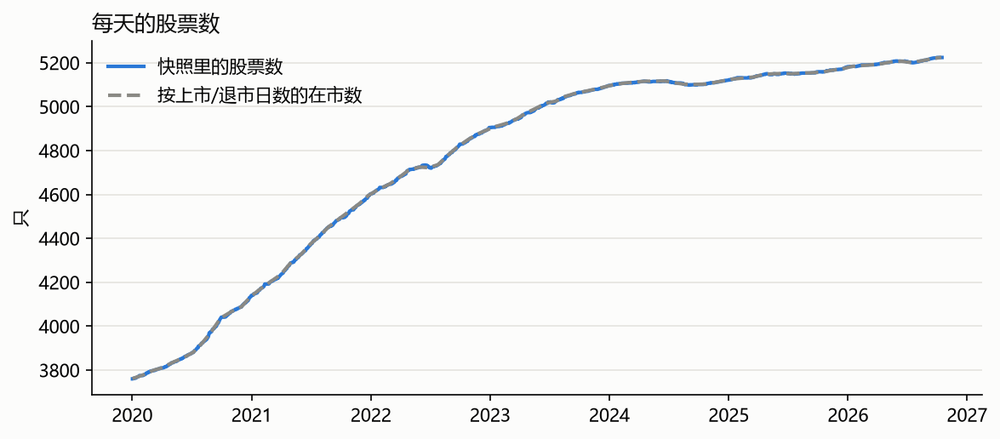
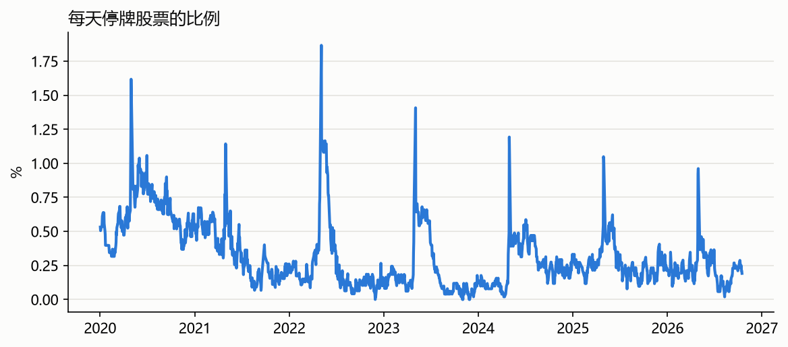

# 数据质量报告

生成时间：2026-11-15 14:44。数据：7,841,282 行，5448 只股票，2020-01-02 至 2026-10-16。

只做结构性检查，不计算信号和收益的关系。

## 1. 每天的股票数

- 首日 3760 只，末日 5224 只。
- 与 `stock_basic` 按上市日/退市日数出的在市数相比，差值在 -1 到 2 只之间（每 20 个交易日比一次）。

## 2. 停牌

- 全样本停牌行占 0.302%，单日最高 1.87%（2022-05-05）。
- 停牌日的价格已置为缺失，成交量、成交额记 0。
- 有 8 行标记为停牌但有成交：保留价格，但按不可交易处理。

最长的连续停牌：

| code      | start               | end                 |   days |
|:----------|:--------------------|:--------------------|-------:|
| sz.000670 | 2020-03-20 00:00:00 | 2022-08-19 00:00:00 |    589 |
| sz.002260 | 2020-01-02 00:00:00 | 2022-04-29 00:00:00 |    563 |
| sz.000792 | 2020-04-30 00:00:00 | 2021-08-09 00:00:00 |    311 |
| sz.002450 | 2020-01-02 00:00:00 | 2021-04-13 00:00:00 |    309 |
| sz.300362 | 2020-04-30 00:00:00 | 2021-07-16 00:00:00 |    295 |
| sh.600485 | 2020-04-21 00:00:00 | 2021-06-01 00:00:00 |    270 |
| sz.002711 | 2020-04-30 00:00:00 | 2021-06-01 00:00:00 |    263 |
| sh.600891 | 2020-03-03 00:00:00 | 2021-03-18 00:00:00 |    255 |
| sz.000760 | 2020-06-04 00:00:00 | 2021-06-09 00:00:00 |    247 |
| sz.002359 | 2020-06-24 00:00:00 | 2021-06-09 00:00:00 |    233 |

## 3. 重复代码

全市场扫描，相同天数 ≥ 20 的代码对：

| code_x    | code_y    |   相同的天数 |
|:----------|:----------|--------:|
| sz.300114 | sz.302132 |    1228 |

- 已处理：`sz.300114` → `sz.302132`（2025-02-14 及之前用旧代码的数据）。合并后只保留新代码。
- 新代码在切换后首日的后复权价等于不复权价（因子丢失），已用旧代码最后一天的因子补上。

## 4. 截止日

- 截止日 2026-10-16。5224 只股票的最后一天是截止日。
- 224 只更早结束，其中 224 只在 `stock_basic` 里有退市日，0 只没有退市日。
- 截止日仍有数据但已登记退市日的股票：5 只。

## 5. 涨跌停价

- 校验了 7,806,916 行，违规 0 行，违规率 0.00000%（标准 < 0.1%）。
- 违规 = 最高价超过涨停价、或最低价低于跌停价超过 0.01 元。
- 松紧检查：最高价接近涨幅上限的 204,287 行里，89.2% 的最高价正好等于算出的涨停价。
- 不算涨跌停价的行（新股无限制日、退市整理期首日、恢复上市首日）：5,250 行。

违规明细：

| date   | code   | isST   | preclose_raw   | high_raw   | low_raw   | up_limit   | down_limit   |
|--------|--------|--------|----------------|------------|-----------|------------|--------------|

## 6. 复权

- 清洗后的数据里后复权因子变动 26,279 次（修复前的快照是 26,297 次，对不上 310 次）；东方财富分红送转表里的除权除息日 26,128 个。
- 两边对得上 25,993 次（98.9%）。
- **只在数据里有、分红表里没有：286 次**（配股、重整转增等分红表不收录的事件，已用交易所前收盘价逐日核实）。清单在 `reports/adj_events_unverified.csv`。
- 对上面清单涉及的 205 只股票，下载了交易所的前收盘价逐日核实：
  - 修复前：后复权日收益错误 **34 行**（23 只股票），其中 25 行误差小于 10%，涨跌停校验查不出来。明细在 `reports/adj_repaired_rows.csv`。
  - 修复后（用真实日收益重建这些股票的后复权价）：还剩 **0 行**。
- 未核实的范围：其余股票只验证了“因子变动的日期 = 真实除权除息日”，没有验证变动的幅度。
- 只在分红表里有、快照因子没变：135 次（多数是每股分红不到 1 分钱，因子变动小于阈值）。
- 因子下降（正常除权只会让因子上升）1 次：

| date       | code      |   close_raw |   preclose_raw |    因子变动 |
|:-----------|:----------|------------:|---------------:|--------:|
| 2020-06-30 | sh.600145 |        2.71 |            nan | -0.3439 |

## 7. 退市

|   最后交易年份 |   股票数 |
|---------:|------:|
|     2020 |    16 |
|     2021 |    20 |
|     2022 |    43 |
|     2023 |    45 |
|     2024 |    52 |
|     2025 |    29 |
|     2026 |    19 |

- 共 224 只在截止日前结束。其中 107 只识别出退市整理期（最后一次复牌到结束不超过 30 个交易日）。
- 其余 117 只没有整理期（吸收合并、交易类退市、旧规等），需要在第 3 步逐类确定结算价。
- 最后交易日到登记退市日的间隔：中位数 0 天，最长 3 天。

## 8. 抽样交叉核对（固定随机种子抽 20 只）

- BaoStock 不复权日K：20 只，28,099 行。
  - `open_raw` 与 BaoStock 相差超过 0.005 元：0 行
  - `high_raw` 与 BaoStock 相差超过 0.005 元：0 行
  - `low_raw` 与 BaoStock 相差超过 0.005 元：0 行
  - `preclose_raw` 与 BaoStock 相差超过 0.005 元：0 行
  - 后复权日收益与交易所涨跌幅（pctChg）相差超过 0.05%：0 行
- akshare（新浪财经）不复权日K：20 只，28,099 行。
  - 收盘价相差超过 0.005 元：0 行
  - 成交额相差超过 0.1%：1 行

## 9. 字段

- (日期, 代码) 重复：0 行；股票内部缺交易日：0 行（快照画像时已查）。
- `peTTM` 为负（亏损）：22.4% 的行；等于 0：0 行。`pbMRQ` 为负：0.83%。
- 有成交但换手率为 0 或缺失：13 行（成交只有几百股），流通股本沿用前值。
- 流通市值缺失：2322 行。
- 日均成交价（成交额 ÷ 成交量）落在当日最低价和最高价之外：64 行（0.0008%）。
